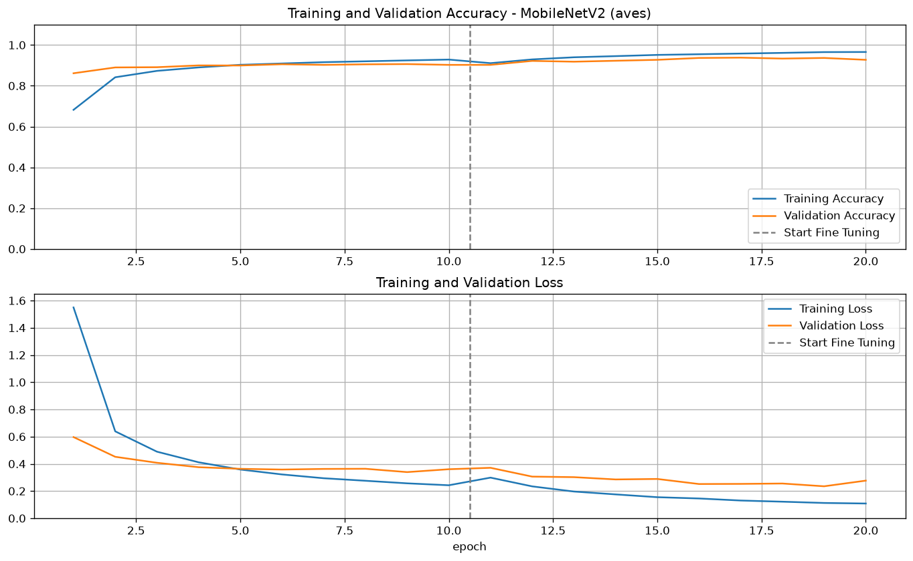
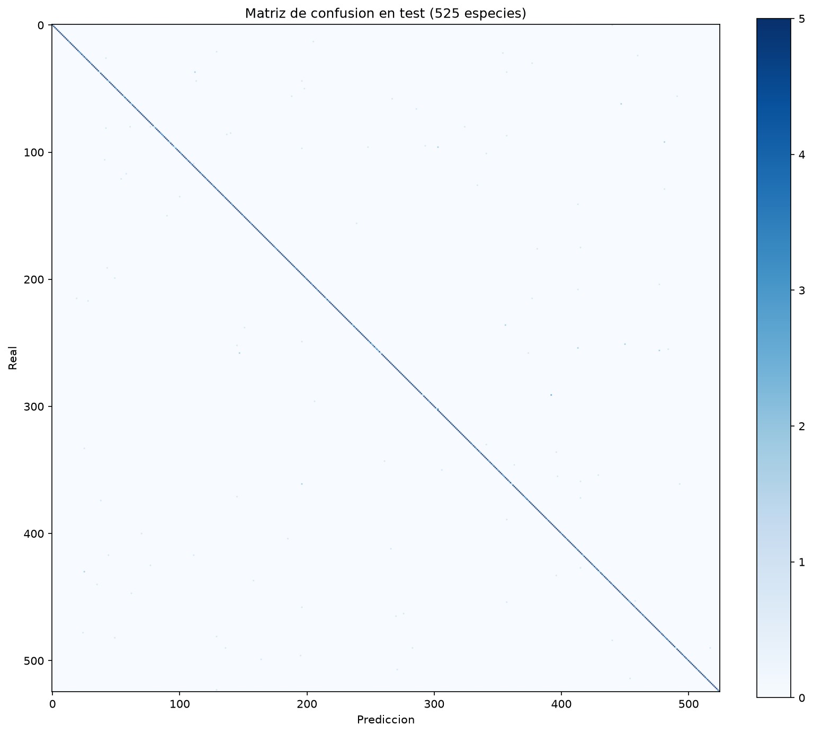
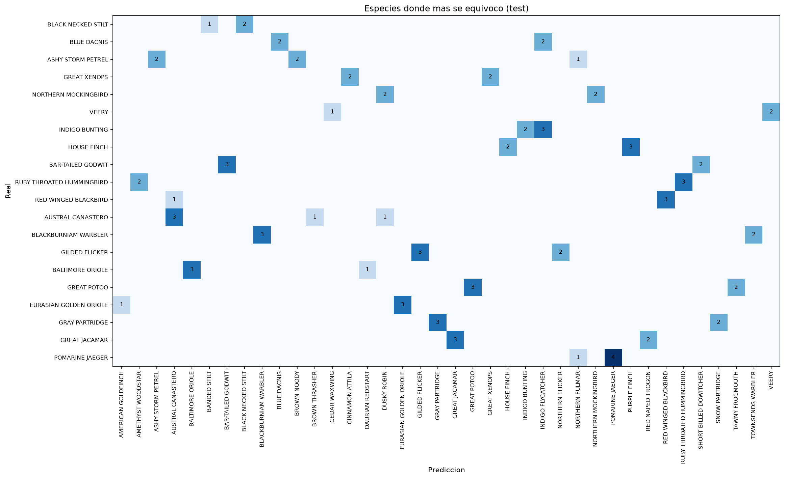

# Clasificación de 525 especies de aves con transferencia de aprendizaje

Proyecto de la materia **Redes Neuronales**, Universidad de Sonora.
Autor: Kevin Osmar Núñez Manríquez

Se usó **transferencia de aprendizaje** con **MobileNetV2** (preentrenada en ImageNet) para clasificar fotos de aves en 525 especies. El modelo se entrenó en el clúster **YUCA** de la UNISON con un ambiente de conda propio, y después se exportó a TensorFlow.js para usarlo desde el celular.

- **Aplicación web (celular):** https://kevinnunez-bit.github.io/aves-tl/
- **Artículo en Medium:** https://medium.com/@kevinosmar/reconociendo-525-especies-de-aves-con-transferencia-de-aprendizaje-4fa0f25b9b99

## Dataset

[BIRDS 525 SPECIES - IMAGE CLASSIFICATION](https://www.kaggle.com/datasets/gpiosenka/100-bird-species) (Kaggle), fotos a color de 224×224.

| Conjunto | Imágenes |
|---|---|
| Entrenamiento (train) | 84,635 |
| Validación (valid) | 2,625 (5 por especie) |
| Prueba (test) | 2,625 (5 por especie) |

> Nota: la carpeta `PARAKETT  AUKLET` viene con doble espacio en `train` y `test`, pero con uno solo en `valid`. Se renombró en los tres conjuntos para que las clases coincidieran.

## Modelo

```
Entrada 224×224×3
  → preprocess_input de MobileNetV2 (escala los píxeles a [-1, 1])
  → MobileNetV2 sin la capa de clasificación (include_top=False)
  → GlobalAveragePooling2D
  → Dropout(0.2)
  → Dense(525)
```

El entrenamiento se hizo en dos etapas:

1. **Capa nueva (10 épocas):** MobileNetV2 congelada; solo se entrena la capa Dense (672,525 parámetros). Adam con learning rate 0.001.
2. **Ajuste fino (10 épocas):** se descongelan las capas de MobileNetV2 desde la 130 hasta la 154 y se entrena con learning rate 0.0001, para no perder lo que la red ya había aprendido en ImageNet.

También se usó un aumento de datos ligero (volteo horizontal y rotación de ±5%) solo en entrenamiento.

## Resultados

El entrenamiento completo tardó **55.6 minutos** en la partición de CPU del YUCA (32 núcleos, ~3 minutos por época).

| Conjunto | Accuracy | Loss |
|---|---|---|
| Entrenamiento | 97.55% | 0.078 |
| Validación | 92.72% | 0.277 |
| **Prueba** | **95.39%** | 0.154 |



La línea punteada marca el inicio del ajuste fino: en ese punto la validación pasa de ~90% a ~93%.

### Matriz de confusión

Con 525 clases no se pueden leer los nombres, pero casi todo cae en la diagonal:



Las 20 especies con más errores en prueba. La mayoría son confusiones entre aves muy parecidas, por ejemplo *House Finch* con *Purple Finch* o *Indigo Bunting* con *Indigo Flycatcher*:



El reporte completo por especie (precision, recall y f1) está en [`resultados/reporte_test.txt`](resultados/reporte_test.txt).

## Aplicación para celular

La carpeta [`docs/`](docs/) es una página web que se publica con GitHub Pages. Usa la cámara del celular en vivo (o una foto de la galería) y muestra las 3 especies más probables. El modelo corre directamente en el navegador con TensorFlow.js, sin servidor.

Para la conversión ([`exportar_tfjs.py`](exportar_tfjs.py)):
- se agregó una capa softmax al final para obtener probabilidades;
- se exportó como *graph model*, porque las capas de `preprocess_input` no son compatibles con `tf.loadLayersModel`;
- los pesos se guardaron en float16, así el modelo pesa ~5.6 MB en lugar de ~11 MB.

## Archivos

| Archivo | Descripción |
|---|---|
| [`aves_tl.py`](aves_tl.py) | Código de entrenamiento y evaluación |
| [`aves_tl.slrm`](aves_tl.slrm) | Script de Slurm para mandar el trabajo al YUCA |
| [`tl_aves.yml`](tl_aves.yml) | Ambiente de conda exportado |
| [`slurm-2231927.out`](slurm-2231927.out) | Salida completa del entrenamiento en el YUCA |
| [`resultados/`](resultados/) | Gráficas, matriz de confusión, reporte, historial y modelo (`modelo_final.h5`) |
| [`exportar_tfjs.py`](exportar_tfjs.py) | Conversión del modelo a TensorFlow.js |
| [`docs/`](docs/) | Aplicación web para el celular |

## Cómo reproducirlo en el YUCA

1. Crear el ambiente de conda (en el nodo de login, que sí tiene internet):
   ```bash
   source /apps/miniconda3/etc/profile.d/conda.sh
   conda create -n tl_aves python=3.11 -y
   conda activate tl_aves
   pip install tensorflow-cpu==2.15.1 scikit-learn matplotlib pillow
   # descarga previa de los pesos de ImageNet
   python -c "import tensorflow as tf; tf.keras.applications.MobileNetV2(input_shape=(224,224,3), include_top=False, weights='imagenet')"
   ```
   O directamente desde el archivo exportado: `conda env create -f tl_aves.yml`

2. Descargar el dataset de Kaggle dentro de `~/aves_tl/Dataset_Aves` (con las carpetas `train/`, `valid/` y `test/`).

3. Mandar el trabajo y revisar su avance:
   ```bash
   sbatch aves_tl.slrm
   squeue -u $USER
   tail -f slurm-<JOBID>.out
   ```

4. Exportar el ambiente:
   ```bash
   conda env export -n tl_aves > tl_aves.yml
   ```

Se usó la partición de CPU porque las GPUs del YUCA son AMD (Instinct MI210) y requieren TensorFlow con ROCm. Con la base congelada, el entrenamiento en CPU fue suficientemente rápido.
